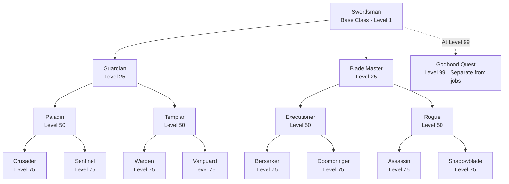

# MMORPG Project (Working Title)

An original browser-based MMORPG inspired by the accessibility and gameplay approach of games such as Lumivara, with a branching job progression system and a Godhood endgame advancement.

The project is being developed as its own intellectual property. Its world, characters, classes, skills, progression, art, and other game content will be original.

## Project Goals

- Playable in modern desktop and mobile browsers.
- Landscape-first mobile experience.
- MMORPG character progression with branching job advancement and Godhood.
- Server-authoritative gameplay and character data.
- An approachable visual and animation scope that can be expanded over time.

## Technology Stack

| Area | Technology |
|---|---|
| Game client | Phaser 4, TypeScript |
| Client tooling | Vite |
| Game server | Node.js, TypeScript |
| Shared code | TypeScript workspace package |
| Networking | WebSockets (planned) |
| Database | PostgreSQL (planned) |
| Cache / transient state | Redis (planned) |
| Map editor | Tiled |
| Pixel-art editor | Aseprite (optional; not installed yet) |

## Character Foundation

### Basic Classes

The initial character roster consists of five basic classes:

1. Swordsman
2. Archer
3. Shaman
4. Brawler
5. Gunner

Each basic class will have its own branching job progression. The number and names of the job paths must be finalized class by class before implementation.

### Swordsman

Swordsman is the first class being designed in detail. Its job structure is a branching progression, not a flat list of three interchangeable specializations.

#### Advancement milestones

| Character level | Advancement | Rule |
|---:|---|---|
| 1 | Swordsman | Base class; uses its fixed class skills. |
| 25 | First job | Choose one of two jobs. |
| 50 | Second job | Choose one of two jobs connected to the selected first job. |
| 75 | Third job | Choose one of two final jobs connected to the selected second job. |
| 99 | Godhood quest unlock | The character may pursue a chosen deity's trial. |

Job choices are permanent. A character cannot switch to a different branch after making an advancement choice.

#### Swordsman job tree

The following Mermaid diagram is the canonical Swordsman progression. It is kept in the README so the branch relationships remain visible and unambiguous.

**Branch rules:** Choose one first job at Level 25, one connected second job at Level 50, and one connected final job at Level 75. Each choice is permanent. Godhood unlocks at Level 99 and is not a job or another branch in the job tree.

#### Swordsman job names currently discussed

| Advancement | Job | Status |
|---|---|---|
| Level 25 | Guardian | Proposed first-job choice; confirmed name |
| Level 25 | Blade Master | Proposed first-job choice; confirmed name |
| Level 50 under Blade Master | Executioner | Proposed second-job choice; confirmed name |
| Level 50 under Blade Master | Rogue | Proposed second-job choice; confirmed name |
| Level 50 under Guardian | Paladin | Confirmed second-job name; defensive protector direction |
| Level 50 under Guardian | Templar | Confirmed second-job name; offensive defender / counterattack direction |
| Level 75 under Executioner | Berserker | Confirmed third-job name; aggressive greatsword specialist |
| Level 75 under Executioner | Doombringer | Confirmed third-job name; deliberate high-impact greatsword specialist focused on armor destruction and finishing attacks |
| Level 75 under Rogue | Assassin | Confirmed third-job name; ambush and critical-strike specialist focused on lethal single-target attacks |
| Level 75 under Rogue | Shadowblade | Confirmed third-job name; mobile melee specialist focused on rapid attacks, evasion, and combos |
| Level 75 under Paladin | Crusader | Confirmed third-job name; holy protector focused on divine buffs, healing, and shielding |
| Level 75 under Paladin | Sentinel | Confirmed third-job name; defensive specialist focused on damage absorption, enemy control, and frontline protection |
| Level 75 under Templar | Warden | Confirmed third-job name; counterattack specialist who punishes enemies for attacking or breaking through defenses |
| Level 75 under Templar | Vanguard | Confirmed third-job name; aggressive frontline warrior focused on charges, disruption, and offensive protection |

The earlier flat Swordsman specialization concept (Guardian, Blade Master, Executioner) is superseded by this branching structure. Executioner is currently a second-job branch under Blade Master, not a direct first-job choice.

#### Current job identity concepts

- **Guardian:** Defensive frontline / tank. The current primary-status recommendation is VIT. Its two confirmed second-job branches are **Paladin** (defensive protector) and **Templar** (offensive defender focused on counterattacks). Paladin's confirmed level-75 branches are **Crusader** (holy protection, divine buffs, healing, and shielding) and **Sentinel** (damage absorption, enemy control, and frontline protection). Templar's confirmed level-75 branches are **Warden** (counterattacks and punishing enemies that attack or break through defenses) and **Vanguard** (aggressive frontline charges, disruption, and offensive protection).
- **Blade Master:** Dual-sword melee combat concept; fast attacks, chained combos, and parries.
- **Executioner:** Aggressive greatsword specialist focused on high-damage attacks, armor penetration, devastating combos, and finishing strikes. Its confirmed level-75 branch **Berserker** develops this aggressive identity further; its other confirmed level-75 branch is **Doombringer**, a deliberate, high-impact greatsword specialist focused on armor destruction and finishing attacks.
- **Rogue:** Offensive melee concept emphasizing attack and attack speed. Its two confirmed level-75 branches are **Assassin** (ambushes, critical strikes, and lethal single-target attacks) and **Shadowblade** (mobility, rapid attacks, evasion, and combos). Detailed weapon configuration and mechanics remain to be finalized.

All remaining branches, skills, attributes, and balance values are still under discussion.

### Character Attributes and Status Guide

The six primary attributes are:

- STR
- DEX
- VIT
- INT
- AGI
- LCK

The initial attribute-effect reference is based on the supplied Lumivara screenshots. The effects below are a design baseline, not finalized numerical formulas:

| Attribute | Reference effects |
|---|---|
| STR | Increases physical ATK. Melee weapons gain +3 ATK per point; ranged weapons gain +1 ATK per 5 STR. |
| DEX | Increases HIT by +2 per point. Bows and other ranged weapons gain +3 ATK per point; melee weapons gain +1 ATK per 5 DEX. Also affects MATK, casting time, and ASPD. |
| VIT | +10 MAX HP per point, +0.6% total MAX HP per point, +1 DEF per 15 VIT, faster natural HP recovery, and reduced stun duration. |
| INT | +3 MATK per point, +1 MDEF per 10 INT, and +5 MAX SP per point. |
| AGI | +2 FLEE per point and increases ASPD. |
| LCK | +1% CRITICAL and +1 HIT per 3 LCK, +1 FLEE per 5 LCK, and +1 ATK per 10 LCK. |

The Status Guide will recommend only one primary attribute for each job. It will explain why that attribute supports the job's identity. All other attributes remain the player's choice; the guide will not prescribe secondary or optional attributes.

Guardian's current primary-status recommendation is **VIT**, because VIT improves HP, DEF, natural HP recovery, and stun resistance.

### Skill System

The base class and advanced jobs use different skill systems:

- **Base class:** Fixed skills. The player does not choose skills through a skill tree.
- **After first job advancement:** The selected job unlocks its own skill tree.
- **Job skill selection limit:** A player may learn up to seven skills from that job's skill tree.
- **Skill categories:** Active and passive skills both count toward the seven learned-skill limit.
- **Player choice:** The player decides the active/passive mix, such as two active and five passive skills, or another combination totaling seven.
- **Skill upgrades:** Each learned skill has its own upgrade levels. Upgrading a learned skill does not consume another slot from the seven-skill limit.

The number of passive skills is not fixed. A job may have two, three, or another suitable number of passive options in its tree. The tree should offer meaningful choices rather than require every player to use the same build.

### Swordsman Base-Class Skills

The Swordsman base class (Levels 1-24) has exactly **four fixed skills**, and all four are active. The base class uses a **single sword**. These skills are available before the Level 25 first-job advancement.

| Skill | Type | Confirmed design |
|---|---|---|
| **Gale Strike** | Active · Offensive | A powerful sword strike. It uses the same animation as the basic attack. |
| **Wind Cutter** | Active · Offensive | The Swordsman points the sword toward the selected enemy. A whirlwind forms at the sword and travels toward that enemy. It is single-target and stops when it hits the selected enemy. |
| **Blade Rush** | Active · Offensive | The Swordsman draws an X-shaped motion with the sword and launches an X-shaped blade projectile. It travels in a straight line, hits the first enemy along its path, and stops on impact. |
| **Guard** | Active · Defensive | Creates a visible energy shield around the Swordsman for **4 seconds**. The character can move and attack while the shield is active. |

**Player-controlled skill combos:** The player assigns the four skills independently to their preferred skill slots and decides which order to use them in. There is no mandatory combo sequence or automatic combo chain. Skill animations should support smooth transitions when players chain different skills.

The skill names and core behaviors above are confirmed. Damage values, damage reduction, cooldowns, offensive skill durations where applicable, resource costs, exact visual effects, and other numerical balance values remain undecided and must not be invented during implementation.

The exact skill lists, prerequisites, upgrade caps, respec rules, and whether job advancement preserves access to base-class skills remain to be finalized.

## Godhood

Godhood is a separate endgame advancement, not a job or another job specialization.

### Unlock and divine trial

- Reaching character level 99 unlocks the Godhood quest system.
- The player chooses a deity to challenge.
- Each deity has its own quest and trial.
- The character must face the chosen deity in a special encounter and prove their worth.
- Passing the trial grants that deity's divine power.
- Failing a trial imposes an **8-hour cooldown** before the player can retry that deity's trial.

The cooldown must be enforced by the authoritative server, not by the client clock.

### Divine power

A successful Godhood trial grants:

1. Additional character attributes defined by the chosen deity.
2. One unique divine effect.

Divine effects may be either **Active** (manually activated by the player) or **Passive** (triggered automatically by a defined condition). Each deity's effect has its own cooldown.

A character chooses one deity. Deity choice is independent of job: characters from different job paths may choose the same deity. Godhood should complement a job's existing combat identity rather than replace it.

### Illustrative deity concepts (not finalized)

- **Zeus:** A possible Active effect with a five-minute cooldown. The example effect increases movement speed and attack speed and gives attacks a chance to stun.
- **Ares:** A possible Passive effect with a three-minute cooldown. The example effect triggers when HP reaches 50% or lower and increases all six primary attributes for a defined duration. Additional physical and magical attack bonuses were also discussed.

These are brainstorming examples only. Attribute bonuses, percentages, trigger rules, durations, cooldown start conditions, PvP behavior, and final deity effects have not been balanced or approved.

## Character Appearance and Equipment

The current direction is to keep the character's visible appearance independent of equipped gear, reducing the initial sprite and animation workload. Equipment can still provide loot, attributes, and progression benefits. This direction can be revisited if the art pipeline later supports visual equipment changes.

## Rebirth System

A rebirth system remains a core game goal, but its rules are not finalized. Decisions still needed include:

- Rebirth level and eligibility requirements.
- Whether character levels and attributes reset.
- Which progression, items, or bonuses are retained.
- How rebirth interacts with job advancement and Godhood.
- How to prevent excessive stat inflation and preserve meaningful balance.

No rebirth behavior should be implemented until these rules are agreed upon.

## Current Development Status

- [x] Created the initial npm workspace structure.
- [x] Installed the initial Phaser 4, Vite, and TypeScript dependencies.
- [x] Confirmed the Phaser client starts in the browser.
- [x] Agreed on the five initial basic classes.
- [x] Established the Swordsman branching advancement milestones: levels 25, 50, and 75.
- [x] Established level 99 as the Godhood quest unlock.
- [x] Established the initial six primary attributes and Status Guide approach.
- [x] Established fixed base-class skills and a seven-learned-skill job skill tree.
- [x] Established the Godhood deity-trial concept and eight-hour failed-trial cooldown.
- [x] Confirm all Swordsman job names and branching paths.
- [x] Define the four active Swordsman base-class skills and their core behaviors.\n- [ ] Design and balance advanced Swordsman job skills and finalize skill numerical values.
- [ ] Finalize attribute formulas and derived combat statistics.
- [ ] Define Godhood deities, divine effects, and numerical balance.
- [ ] Design the remaining four basic classes and their job paths.
- [ ] Finalize the rebirth rules.
- [ ] Establish sprite dimensions, animation requirements, and asset conventions.
- [ ] Build the character creation and selection flow.
- [ ] Implement server-authoritative character progression and persistence.

## Development Principles

- Agree on game design before implementing systems that depend on it.
- Keep important gameplay decisions documented here or in dedicated design documents.
- Keep character progression and combat outcomes authoritative on the server.
- Validate client input and never trust the client to determine rewards, stats, or damage.
- Build reusable systems instead of duplicating logic for every job.
- Do not finalize speculative mechanics, class names, or balance values as if they were approved decisions.
